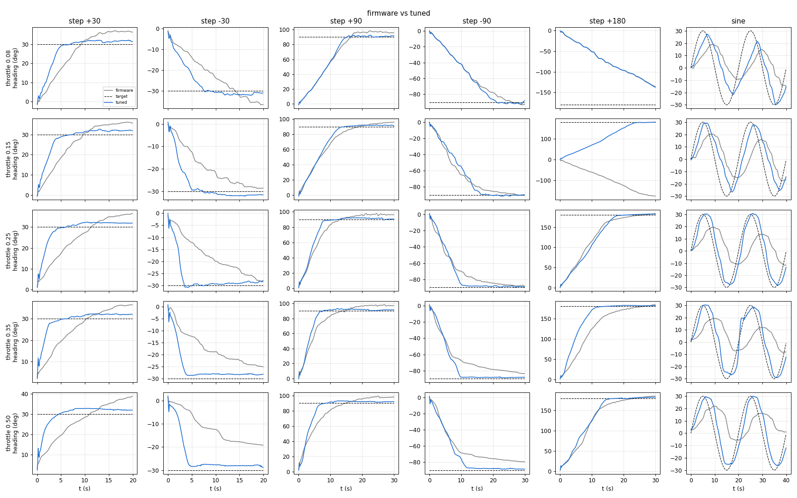

# Chỉnh PID giữ hướng của F407 (Gazebo)

Mục tiêu: thuyền quay tới hướng mà Pi ra lệnh nhanh, ít vượt, không lệch xác lập, ở các mức ga thuyền thật hay chạy (Pi đã có trim tốc độ nên ga thường chỉ 0,1–0,3).

**Kết quả ngắn gọn.** Bộ hệ số `tuned` (Kp 0,10, Ki 0,010, Kd 0,008, tích phân chỉ chạy khi |sai số| < 15°, nhân u khi ga < 0,15) cho kết quả sau so với firmware hiện tại (Kp 0,020, Ki 0,002, Kd 0,008):

- **Vào dải ±5°:** 24/25 ca bước so với 8/25 ca. Ca còn lại là 180° ở ga 0,08, cần hơn 30 s.
- **Thời gian lên 10–90 % với bước 30°:** khoảng 3 s thay vì 7–18 s.
- **Độ vượt:** dưới 3,2° thay vì 6–9°.
- **Sai số cuối:** dưới 2,1° thay vì 6–11°.
- **Bám sine ±30°:** RMS 7–14° thay vì 22°, trễ 0,8–2 s thay vì 4,5–5 s.

**Đã áp vào firmware ngày 13/11/2026** (`STM32F4/App/app_config.h`, `heading_controller.c/.h`, `control.c`, theo [heading_pid_proposal.patch](heading_pid_proposal.patch)). Firmware build Debug OK, test C PASS, nhưng **chưa nạp và chưa thử trên nước**: thử theo mục 6 trước khi dùng thi đấu. Trong bảng dưới, "firmware" là bộ hệ số cũ trước 13/11, nay mang tên `legacy` trong sim.

## 1. Cách đo

[sim/tools/heading_step_test.py](../../../sim/tools/heading_step_test.py) dựng một Gazebo riêng (GZ_PARTITION riêng):

- **Thế giới:** vedc_wide.sdf, bỏ phao mốc, người và phần render cảm biến, còn sóng và thuyền. Đạt RTF ≈ 1,0.
- **F407:** [stm32_board_sim.py](../../../sim/tools/stm32_board_sim.py).
- **Vai Pi:** script tự gửi `$NAV AUTO <tốc độ> <hướng>` mỗi 50 ms và `$HBT` mỗi 100 ms, không chạy Rasp_Pi. Như vậy chỉ đo vòng PID + mix của F407.
- **Hướng thật:** lấy từ odometry của model, theo thời gian sim.

Mỗi ca: tắt máy, đưa thuyền về gốc tọa độ, mũi hướng Bắc, chạy thẳng 8 s ở mức ga của ca (tốc độ = ga × 1 m/s), rồi đổi đích:

- **Bước:** +30, −30, +90, −90, 180° (theo dõi 20 s cho bước 30°, 30 s cho các bước khác).
- **Sine:** biên độ 30°, chu kỳ 20 s, trong 40 s.
- **Mức ga:** 0,08, 0,15, 0,25, 0,35, 0,5. Ga 0,08 được thêm vì đội fleet thấy thuyền mất hướng khi bò chậm ở ga 0,03–0,1.

Chỉ số:

- **rise:** thời gian sai số đi từ 90 % xuống 10 % của bước.
- **vượt:** độ quay quá đích.
- **xác lập:** thời điểm sai số vào hẳn ±5°; "—" là không vào được trong cửa sổ đo.
- **sai số cuối:** trung bình 5 s cuối.
- **bán kính:** tốc độ / tốc độ quay trong lúc quay. Tốc độ quay tính bằng độ dốc của hướng qua 1 s, vì yaw rate của odometry dao động ±10°/s theo sóng.
- **sine:** RMS sai số trong chu kỳ thứ hai, và độ trễ khớp nhất.

```bash
source sim/env.sh
python3 sim/tools/heading_step_test.py --gains legacy              # ~25 phút, hệ số trước 13/11
python3 sim/tools/heading_step_test.py --gains firmware            # hệ số hiện tại (= tuned)
python3 sim/tools/heading_step_test.py --sysid                     # u bậc vòng hở
python3 sim/tools/heading_step_test.py --compare media/simulation/pid/firmware_samples.csv media/simulation/pid/tuned_samples.csv
python3 sim/tools/heading_tune_model.py --sysid media/simulation/pid/sysid_metrics.csv
python3 sim/tools/heading_controller_test.py                       # kiểm tra đơn vị
```

## 2. Nhận dạng hệ (sysid, vòng hở)

Ở chế độ `--sysid` script không chạy board. Nó gửi thẳng lệnh của `heading_mix(u, ga)` (rudder pod + chênh lệch hai máy sau + máy trước) lên các joint: thuyền chạy thẳng 8 s, rồi giữ u cố định 12 s. Kết quả ([sysid_metrics.csv](sysid_metrics.csv)), với tốc độ quay xác lập là độ dốc của hướng trong 8 s cuối:

| ga | u | tốc độ quay (°/s) | tốc độ (m/s) | bán kính (m) |
|---|---|---|---|---|
| 0.05 | +0.3 / +0.6 / +1.0 / −0.6 | +1.8 / +2.6 / +4.7 / −3.4 | 0.47 | 15 / 11 / 6 / 8 |
| 0.08 | +0.3 / +0.6 / +1.0 / −0.6 | +2.4 / +4.2 / +5.2 / −3.6 | 0.65 | 16 / 9 / 7 / 11 |
| 0.15 | +0.3 / +0.6 / +1.0 / −0.6 | +2.3 / +4.4 / +8.0 / −3.6 | 0.97 | 25 / 13 / 7 / 16 |
| 0.25 | +0.3 / +0.6 / +1.0 / −0.6 | +2.8 / +5.0 / +11.0 / −2.8 | 1.33 | 29 / 15 / 7 / 28 |
| 0.35 | +0.3 / +0.6 / +1.0 / −0.6 | +1.6 / +5.6 / +12.2 / −2.1 | 1.65 | 59 / 17 / 7 / 48 |
| 0.50 | +0.3 / +0.6 / +1.0 / −0.6 | +1.8 / +4.3 / +12.1 / −1.9 | 2.05 | 68 / 27 / 9 / 65 |

Rút ra:

1. **Đáp ứng nhanh.** Tốc độ quay xác lập ngay trong giây đầu ở mọi lần chạy, tức hằng số thời gian dưới ~0,5 s. Mô hình dùng T = 0,3 s.
2. **u nhỏ gần như vô dụng.** u = 0,3 chỉ cho ~2°/s, u = 1 cho 5–12°/s (rudder 22,5° và chênh lệch máy chỉ thắng được độ ổn định hướng của thân thuyền khi lệnh đủ lớn). Với Kp = 0,02, sai số 15° chỉ ra u = 0,3: thuyền tiến về đích với hằng số thời gian ~10 s. Đó là lý do firmware chậm.
3. **Có độ lệch quay phải cố định** khoảng +0,4…+1,8°/s, lớn hơn khi ga cao: ở ga 0,35–0,5, u = −0,6 chỉ quay trái 2°/s, trong khi u = +0,6 quay phải 4–6°/s. Tích phân phải gánh độ lệch này.
4. **Khả năng lái gần như không đổi theo ga** từ 0,15 đến 0,5 (u = 1 cho 8–12°/s). Ở ga 0,05–0,08 nó còn khoảng một nửa (5°/s). Vì vậy **không** chia u cho ga trên toàn dải như ArduPilot, chỉ nhân lên ở ga thấp.
5. **Tốc độ trong sim gấp đôi lệnh:** ga 0,5 cho 2 m/s. Lệnh "1 m/s" của Pi thực ra là ~2 m/s. Đây là tham số lực đẩy đoán trong model.sdf (`--rear-thrust-n 15`), đúng như nhận xét của đội fleet.

## 3. Chỉnh từ dữ liệu

[sim/tools/heading_tune_model.py](../../../sim/tools/heading_tune_model.py) dựng mô hình từ bảng trên:

- **Mô hình:** `r' = (g(u) + bias − r)/T`, `ψ' = r`; g(u) tuyến tính từng đoạn qua các điểm sysid; thêm dao động sóng 1 Hz, 4°/s trên gyro.
- **Bộ điều khiển:** dùng đúng `HeadingController` của board sim.
- **Kiểm chứng mô hình:** với hệ số firmware ở ga 0,25, bước +90°, mô hình cho rise 10,1 s / vượt 10,6° / sai số cuối −4,9°; Gazebo cho 8,7 s / 7,9° / −6,3°.
- **Tìm lưới:** 768 bộ (Kp, Kd, Ki, vùng tích phân, có/không nhân theo ga) trên 6 mức ga × 5 bước.
- **Chi phí:** thời gian xác lập + ½ độ vượt + 2 × |sai số cuối| + 20 × độ rung của u.

| bộ hệ số | chi phí (T = 0,3 s) | T = 0,8 s | T = 1,2 s | vượt lớn nhất (T = 1,2 s) |
|---|---|---|---|---|
| firmware | 1497 | 1524 | 1526 | 20° |
| tốt nhất lưới (Kp 0,14, Kd 0, Ki 0,04) | 465 | 480 | 524 | 5,0° |
| **tuned** (Kp 0,10, Kd 0,008, Ki 0,010) | **499** | **522** | **536** | **5,2°** |

Mặt chi phí khá phẳng quanh tối ưu. Tôi chọn bộ vừa phải: Kp không cao bằng tối ưu và giữ Kd như cũ, vì thuyền thật có servo chậm hơn, BNO055 nhiễu hơn và độ trễ lớn hơn Gazebo. Bộ này vẫn chịu được khi T lên 1,2 s.

**Vì sao từng thay đổi:**

- **Kp 0,02 → 0,10:** u bão hòa khi sai số > 10°, nên thuyền quay hết tốc lâu hơn và vào đích nhanh. Vùng tuyến tính còn hằng số thời gian ~2 s thay vì ~10 s.
- **Ki 0,002 → 0,010, kèm vùng tích phân 15°:** firmware tích phân suốt lượt quay chậm, nên chạm giới hạn 100°·s rồi vượt ~6° và đứng lệch luôn (thấy rõ ở +30° và +90° trong biểu đồ). Giờ tích phân chỉ chạy khi gần đích, và đủ mạnh để bù độ lệch ~1°/s.
- **Kd giữ 0,008:** mô hình cho thấy Kd lớn hơn chỉ làm u rung theo sóng (Kd 0,016: rung 0,21 so với 0,16) mà không giảm vượt.
- **Nhân u theo ga:** `u × max(1, 0,15 / max(ga, 0,05))`, tối đa ×3 ở ga ≤ 0,05. Chỉ có tác dụng trong vùng tuyến tính (sai số < 10°) ở ga thấp. Mô hình được lợi ít (499 so với 506), nhưng đó đúng là vùng đội fleet thấy mất hướng. Từ ga 0,15 trở lên u giữ nguyên.

## 4. Trước / sau (Gazebo)

Giá trị: firmware → **tuned**. Dữ liệu: [firmware_metrics.csv](firmware_metrics.csv), [tuned_metrics.csv](tuned_metrics.csv). Mẫu 10 Hz: `*_samples.csv`.

| ga | ca | rise (s) | vượt (°) | xác lập ±5° (s) | sai số cuối (°) | bán kính (m) |
|---|---|---|---|---|---|---|
| 0.08 | +30° | 6.9 → **4.0** | 7.0 → **2.2** | — → **4.0** | -6.7 → **-1.7** | 10.8 → **5.5** |
| 0.08 | -30° | 12.2 → **6.4** | 6.8 → **2.2** | — → **5.6** | 4.7 → **1.6** | 18.4 → **9.4** |
| 0.08 | +90° | 12.4 → **11.3** | 8.4 → **2.6** | — → **13.7** | -6.4 → **-1.0** | 6.3 → **5.6** |
| 0.08 | -90° | 19.1 → **16.4** | 3.3 → **2.3** | 23.1 → **19.1** | 1.0 → **1.1** | 9.8 → **8.3** |
| 0.08 | 180° | — → **—** | — → **—** | — → **—** | -54.9 → **-54.1** | — → **—** |
| 0.08 | sine ±30° | RMS 21.7 → **14.4** | trễ 4.5 → **2.1** s | max 31.9 → **25.7** | | |
| 0.15 | +30° | 7.4 → **3.5** | 6.2 → **2.6** | — → **3.3** | -5.6 → **-2.0** | 17.8 → **7.8** |
| 0.15 | -30° | 14.1 → **4.4** | 0.0 → **2.1** | 12.8 → **4.2** | -2.0 → **1.7** | 32.8 → **9.2** |
| 0.15 | +90° | 12.5 → **9.7** | 6.1 → **2.5** | — → **11.9** | -5.3 → **-1.8** | 9.5 → **7.3** |
| 0.15 | -90° | 14.5 → **11.9** | 0.5 → **1.5** | 19.2 → **15.2** | -0.5 → **0.4** | 11.4 → **9.3** |
| 0.15 | 180° | 22.1 → **19.2** | 0.0 → **0.4** | 29.7 → **23.1** | -10.2 → **0.8** | 8.5 → **7.0** |
| 0.15 | sine ±30° | RMS 22.3 → **13.1** | trễ 4.4 → **2.1** s | max 32.5 → **21.7** | | |
| 0.25 | +30° | 9.5 → **2.9** | 6.5 → **2.4** | — → **2.6** | -5.6 → **-1.9** | 30.9 → **9.5** |
| 0.25 | -30° | 18.3 → **3.0** | 0.0 → **0.8** | 15.5 → **2.9** | -3.7 → **-1.4** | 56.3 → **9.0** |
| 0.25 | +90° | 8.7 → **6.4** | 7.9 → **2.4** | — → **7.3** | -6.3 → **-0.7** | 9.1 → **6.3** |
| 0.25 | -90° | 14.1 → **7.9** | 0.0 → **0.0** | 20.6 → **9.8** | -2.3 → **-1.2** | 15.4 → **8.2** |
| 0.25 | 180° | 12.8 → **13.7** | 3.7 → **2.5** | 21.3 → **17.1** | -1.0 → **-2.0** | 6.5 → **6.9** |
| 0.25 | sine ±30° | RMS 22.6 → **8.2** | trễ 4.8 → **1.2** s | max 32.7 → **14.5** | | |
| 0.35 | +30° | 8.6 → **2.3** | 6.6 → **2.4** | — → **2.1** | -5.9 → **-2.1** | 34.2 → **9.8** |
| 0.35 | -30° | — → **3.4** | — → **0.0** | — → **3.2** | -6.0 → **-1.8** | — → **12.9** |
| 0.35 | +90° | 8.9 → **4.7** | 8.1 → **3.2** | — → **6.1** | -7.2 → **-1.3** | 10.6 → **5.8** |
| 0.35 | -90° | 23.9 → **7.5** | 0.0 → **0.0** | — → **9.4** | -7.8 → **-1.7** | 32.9 → **10.0** |
| 0.35 | 180° | 13.9 → **7.8** | 4.0 → **2.5** | 22.1 → **10.7** | -1.4 → **-1.7** | 8.6 → **4.6** |
| 0.35 | sine ±30° | RMS 22.4 → **7.2** | trễ 4.9 → **0.8** s | max 35.6 → **12.5** | | |
| 0.50 | +30° | 9.0 → **2.8** | 8.9 → **2.8** | — → **2.2** | -7.1 → **-2.1** | 45.3 → **14.1** |
| 0.50 | -30° | — → **4.1** | — → **0.0** | — → **4.0** | -11.5 → **-1.9** | — → **18.6** |
| 0.50 | +90° | 9.8 → **5.4** | 9.2 → **3.1** | — → **6.0** | -7.7 → **-1.8** | 14.5 → **7.5** |
| 0.50 | -90° | — → **9.5** | — → **0.0** | — → **11.4** | -11.1 → **-1.5** | — → **18.0** |
| 0.50 | 180° | 13.1 → **11.3** | 5.3 → **2.7** | — → **14.2** | -3.7 → **-2.1** | 9.6 → **8.3** |
| 0.50 | sine ±30° | RMS 23.9 → **9.6** | trễ 5.2 → **1.4** s | max 40.2 → **17.3** | | |



Xám là firmware, xanh là tuned, nét đứt là đích (của lần chạy tuned). Từng bộ riêng: [firmware.png](firmware.png), [tuned.png](tuned.png).

Ghi chú về bảng:

- **Bước −30° ở ga 0,35/0,5 với firmware:** thuyền không bao giờ tới đích. u = 0,02 × 30 = 0,6 chỉ đủ quay trái ~2°/s, độ lệch quay phải ăn gần hết, và tích phân quá yếu.
- **180° ở ga 0,15:** firmware quay trái, tuned quay phải. Cả hai đều đúng, vì sai số đúng 180° thì chiều quay do nhiễu quyết định.
- **180° ở ga 0,08:** cả hai không kịp. Tối đa ~5°/s nên cần hơn 36 s, mà cửa sổ đo chỉ 30 s. Đây là giới hạn vật lý, không phải lỗi PID.
- **Sine ở ga thấp vẫn trễ:** sine ±30° chu kỳ 20 s cần tới 9,4°/s, vượt khả năng quay ở ga 0,08–0,15.
- **Sai số cuối ±2° còn lại** là deadband 2° (P nghỉ trong dải này).
- **Một lần Gazebo lỗi:** lần chạy tuned đầu tiên ở ga 0,5, bước +90° có thuyền xoay tròn liên tục ~90°/s (đỉnh 272°/s, gấp >20 lần khả năng lái) mà không có sự kiện lật. Hai lần chạy lại tuned và hai lần chạy lại firmware đều bình thường, nên đây là lỗi vật lý một lần. Bảng dùng lần chạy lại; bản gốc lưu ở `~/vedc_sim/tuned_glitch_+90_0.5.csv` trong WSL. Sysid ở ga 0,5, u = 1 cũng có một xung 26°/s: quay gắt ở 2 m/s gần mép ổn định của mô hình thủy động.

## 5. Hệ số trong sim

```bash
VEDC_SIM_HEADING_GAINS=legacy python3 sim/tools/stm32_board_sim.py ...   # hệ số trước 13/11, để chạy lại vòng 1-2
```

- **Mặc định `firmware`:** giống hệt app_config.h hiện tại (bộ mới). `tuned` là cùng bộ đó, tên mà vòng 3 của đội fleet đã dùng. [heading_controller_test.py](../../../sim/tools/heading_controller_test.py) so từng đầu ra với bản viết lại của heading_controller.c.
- **`legacy`:** Kp 0,020, Ki 0,002, không vùng tích phân, không nhân theo ga, để tái lập các lần chạy trước 13/11.
- **Bảng hệ số:** `HEADING_GAINS` trong [stm32_board_sim.py](../../../sim/tools/stm32_board_sim.py).

## 6. Sửa firmware (đã áp dụng 13/11/2026, chưa thử trên nước)

[heading_pid_proposal.patch](heading_pid_proposal.patch) sửa `app_config.h`, `heading_controller.c/.h`, `control.c` (truyền ga vào PID) và `Tests/heading_controller_test.c`; patch này đã được áp. Test C PASS trên host (gcc), `STM32F4/build.bat Debug` build OK. `sim/tools/f407_board_sim.py` (gọi heading_controller.c qua ctypes) đã truyền thêm ga.

Phần chính:

```c
#define HEADING_KP                 0.10f   /* was 0.020 */
#define HEADING_KI                 0.010f  /* was 0.002 */
#define HEADING_KD                 0.008f
#define HEADING_INTEGRAL_ZONE_DEG  15.0f   /* new */
#define HEADING_SCALE_REF_THROTTLE 0.15f   /* new */
#define HEADING_SCALE_MIN_THROTTLE 0.05f   /* new */

static float throttle_scale(float throttle) {
    const float t = throttle > HEADING_SCALE_MIN_THROTTLE ? throttle : HEADING_SCALE_MIN_THROTTLE;
    return t < HEADING_SCALE_REF_THROTTLE ? HEADING_SCALE_REF_THROTTLE / t : 1.0f;
}
/* HeadingController_Update(..., dt_s, throttle): p, i, d each × scale;
   the integral only grows when |error| < HEADING_INTEGRAL_ZONE_DEG. */
```

**Cách thử trên nước (gợi ý):**

1. **Nạp, đặt thuyền chạy ga 0,15 rồi 0,25.** Từ Pi, cho đích nhảy ±30° và ±90°, ghi `heading_debug` (yaw, u, p/i/d).
2. **Nếu dao động quanh đích** (u đổi dấu liên tục, hướng lắc > ±5°): giảm Kp về 0,06 trước, sau đó mới tăng Kd lên 0,012.
3. **Nếu vẫn đứng lệch > 3° lâu:** tăng Ki lên 0,02.
4. **Sau tích hợp:** Ki × INTEGRAL_LIMIT giờ là 1,0 (trước là 0,2). Nếu thấy tích phân "giật" sau khi đổi đích, hạ INTEGRAL_LIMIT xuống 40.

## 7. Giới hạn: Gazebo khác nước thật

- **Thủy động trong model.sdf là đoán**, chưa đo trên thuyền thật: lực đẩy 15 N/máy, kích thước thân, hệ số cản. Thuyền sim chạy gấp đôi tốc độ lệnh và phản ứng lái rất nhanh (< 0,5 s). Thuyền thật có quán tính lớn hơn, servo chậm hơn (servo trong sim là bộ điều khiển vị trí lý tưởng p_gain 12), ESC trễ hơn. Trễ lớn hơn thì Kp 0,10 dễ dao động hơn; mô hình cho thấy vẫn ổn tới T = 1,2 s, nhưng phải thử.
- **Độ lệch quay phải ~1°/s** đến từ mô hình sóng/thân trong sim. Trên nước thật nó sẽ khác (máy lệch nhau, gió, dòng chảy); tích phân có vùng 15° xử lý được cả hai chiều.
- **Khả năng lái theo ga** (phẳng từ 0,15 trở lên, giảm một nửa ở 0,05–0,08) là đặc điểm của model. ESC thật có vùng chết đầu ga (1550 µs), nên ở ga rất thấp có thể còn yếu hơn. Hệ số nhân theo ga không tạo thêm lực khi u đã bão hòa.
- **Sóng chỉ là sóng FFT 128 ô**, không có gió hay dòng chảy. Gyro trong sim là vi phân odometry, nhiễu khác BNO055.
- **Board sim chạy theo đồng hồ thật**, Gazebo theo đồng hồ sim. Các lần đo có RTF 0,85–1,00, ảnh hưởng nhỏ.
- **Lỗi lớn hơn của bò chậm** mà đội fleet thấy (đích 120°, thuyền tới 290°) còn có nguyên nhân khác ngoài PID: khi Pi cắt ga về 0, F407 reset PID và trả rudder về giữa, nên thuyền mất hết khả năng lái. Ở ga ≤ 0,08 thuyền chỉ quay được ~5°/s. Cần xử lý phía Pi, chẳng hạn giữ một ga tối thiểu khi sai số hướng lớn. Báo cáo này không đo phần đó.
